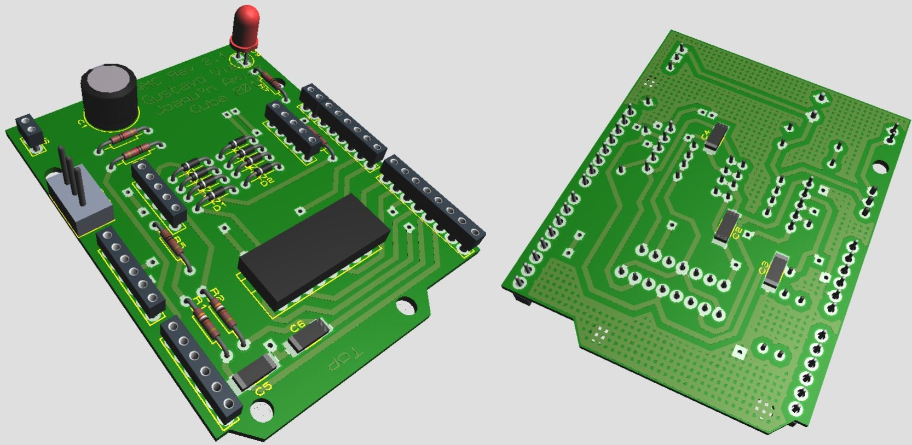

# rosie motor driver

A dual DC motor driver for [rosie](https://github.com/PyForce/rosie) robots: the design of an Arduino shield, and
the firmware that runs on it. The shield drives two motors with encoders and keeps each wheel at the speed rosie
asks for, with its own PID loop.



## What it does

- A speed PID for each wheel, every 25 ms, with the gains rosie sends at start-up.
- Counts each wheel's encoder pulses, for rosie's odometry.
- Talks to rosie over USB (serial, 9600 baud).

Its limits: the encoders are single-channel (no quadrature), so the shield takes a wheel's direction from the
command it gives it; and it doesn't measure the motors' current or the battery (it always reports 0).

## What you need

- An Arduino Uno (or another board with the ATmega328).
- Two DC motors with encoders, below 24 V. We tested it with
  [these 12 V, 62 rpm gearmotors](https://www.robot-italy.com/it/gearmotor-12vdc-62rpm-encoder.html).
- The shield: see below.

Each motor takes five wires: motor (+), encoder signal, encoder GND, encoder VCC, motor (-).

## Making the shield

Everything is in [`hardware/`](hardware):

1. Buy the parts in [`component_list.txt`](hardware/component_list.txt).
2. Make the two-layer board from [`top.pdf`](hardware/top.pdf) and [`bottom.pdf`](hardware/bottom.pdf), printed
   at their real size (1:1).
3. Solder the parts where [`silk.pdf`](hardware/silk.pdf) shows them.

The schematic is [`schematics.png`](hardware/schematics.png), for changing the design.

We made these boards in Cuba, without hardware stores or online shopping. Believe us, it's not that hard.

## Loading the firmware

First set `REVOLUTION_STEPS` in
[`firmware/motorcontroller/motorcontroller.ino`](firmware/motorcontroller/motorcontroller.ino) to your encoders'
steps per wheel turn (the same as `encoder_resolution` in rosie's profile): it is 270.9, LTL3.0's motors; Kevin's
are 40. The shield measures the wheel speeds with it. Then upload it to the Uno from the Arduino IDE, or with
[arduino-cli](https://arduino.github.io/arduino-cli/):

```bash
arduino-cli compile -b arduino:avr:uno firmware/motorcontroller
arduino-cli upload -b arduino:avr:uno -p /dev/ttyACM0 firmware/motorcontroller
```

## Using it with rosie

In your robot's `profile.toml`, the drive is `arduino`, on the board's serial port, with the PID gains rosie
sends to the shield:

```toml
[drive]
type = "arduino"
port = "/dev/ttyACM0"
baudrate = 9600

[drive.gains]
kc = 3.75
ki = 1.25
kd = 1.25
```

rosie's built-in Kevin and LTL3.0 profiles use it. See rosie's
[Robots and hardware](https://github.com/PyForce/rosie/blob/main/docs/robots.md) docs.

## Protocol

One command byte, then its arguments; numbers are little-endian (`float` and `long` are 4 bytes on the Uno).

| Command | Byte | Arguments | Answer |
|---|---|---|---|
| Set the PID gains | `0xA6` | kc, ki, kd (`float`) | |
| Set the wheel speeds | `0xA7` | wheel 1, wheel 2 (`float`, rad/s) | |
| Read the state | `0xA8` | | `0xA9`, then pulses 1, pulses 2 (`long`), battery (byte) |
| Reset the encoders | `0xAA` | | |
| Start sending speeds | `0xAB` | | then every 25 ms: speed 1, speed 2 (`float`, rad/s) |
| Stop sending speeds | `0xAC` | | |

The last two are for tuning the PID; while the speeds are being sent, the shield doesn't answer state reads.

## License

[MIT](LICENSE).
